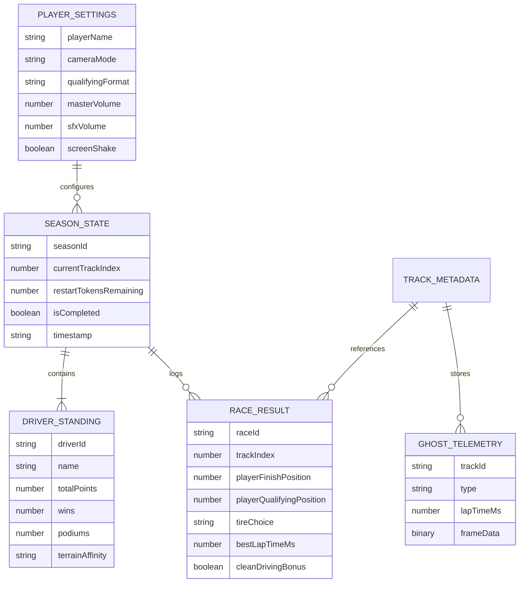
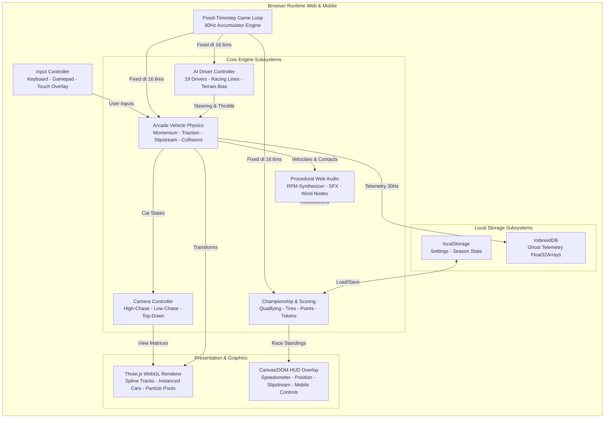

# PROJECT PLAN: Apex Slipstream

Generated: 2026-11-13 | Mode: NEW | Stage: Plan | Rigor Level: LIGHT

---

## 0. Project Profile

| Field | Detail |
|---|---|
| **Name** | **Apex Slipstream** |
| **Type** | Personal Project / Indie Web Game (Public Product) |
| **Owner** | Solo Developer (Personal) |
| **Platform** | Responsive Web App & PWA (Desktop & Mobile) |
| **Public Pages** | Yes (Playable web URL) |
| **Users & Scale** | 100+ launch players; scale-independent (100% client-side computation) |
| **User Locations & Laws** | Global web users; zero personal data collected (GDPR / NDPA duties not triggered) |
| **Languages** | English |
| **Personal Data & Sensitivity** | None collected, stored, or transmitted |
| **Data Protection Role** | N/A (No personal data processing) |
| **Major-Importance Status** | N/A |
| **Data Hosting Regions** | N/A (Static assets served via global Cloudflare Edge CDN) |
| **Payments** | None (100% Free; no IAP, no ads, no payment gateway) |
| **AI Features** | None (19 deterministic/procedural bot drivers; no LLM/Generative AI APIs) |
| **Stack** | **Frontend:** Vite, TypeScript, Three.js (WebGL), Web Audio API, Canvas 2D / CSS UI overlays<br>**Backend/DB:** None (Client-side `IndexedDB` & `localStorage`)<br>**Hosting:** Cloudflare Pages |
| **Key Integrations** | Gamepad API, Screen Orientation API, Fullscreen API |
| **Environments** | Local Dev (`localhost:5173`), Preview (Cloudflare PR deployments), Production (`*.pages.dev` / custom domain) |
| **Recovery Targets** | Max data loss: 1 local race result (mitigated by instant local save writes); Downtime: 0 (Static CDN 99.99% SLA) |
| **Rigor Level** | **LIGHT** (AUDIT_STANDARD: Zero personal data, zero money, zero server risks; high focus on runtime performance, 60 FPS pacing, and touch ergonomics) |

---

## 1. Problem and Outcomes

### Problem Statement & Goal
Arcade racing enthusiasts on web and mobile want an instant, skill-based 3D racing experience without multi-gigabyte downloads, intrusive microtransactions, artificial rubber-banding, or pay-to-win upgrade treadmills. **Apex Slipstream** delivers equal-spec, momentum-based arcade racing featuring dynamic camera views, slipstream drafting, strategic tire choices, and the persistent drama of an 8-race season against 19 named AI rivals directly inside the browser.

### Measurable Success Criteria
1. **Performance:** Solid **60 FPS** sustained on mid-tier mobile hardware (e.g. iPhone 11 / Snapdragon 7xx Android) across all 8 tracks with a full 20-car grid in view.
2. **Bundle & Load Time:** Production bundle $< 4.0\text{ MB}$ uncompressed ($< 1.5\text{ MB}$ gzipped), achieving initial interactive load in $< 2.0\text{ seconds}$ on 4G connections.
3. **Gameplay Completion:** A player can successfully complete a full 8-race championship season from Race 1 qualifying to championship trophy ceremony with 100% state persistence in `localStorage`.
4. **Replay Accuracy:** Time Trial mode accurately records and plays back personal best and previous lap ghost telemetry at 30 Hz with zero visual drift or desynchronization.

### User Stories & Acceptance Criteria

- **US-01 (Championship Season Loop):**  
  *As a player*, I want to compete across an 8-track championship against 19 persistent AI drivers,  
  *So that* I experience the long-term drama, points race, and rivalry of an authentic racing season.  
  *Acceptance Criteria:*
  - Driver standings table updates after each race awarding points from 1st down to 15th (25 down to 1) + 1 pt for fastest lap + 2 pts for clean driving.
  - Driver names and points persist across browser refreshes and tab closures.
  - 3 Restart Tokens are granted per season; restarting a race consumes 1 token. When 0 tokens remain, restart is disabled.

- **US-02 (Momentum & Slipstream Passing):**  
  *As a player*, I want to draft in the aerodynamic wake of rival cars,  
  *So that* I gain extra top speed to slingshot past on straights and into braking zones.  
  *Acceptance Criteria:*
  - Trailing within a $20\text{m}$ wake cone directly behind a rival for $> 1.5\text{ seconds}$ grants a $+8\%$ to $+10\%$ top-speed boost.
  - Visual wind streamlines appear and an audio whoosh plays while slipstreaming.
  - Exiting the slipstream allows carrying the momentum forward for $1.0\text{ second}$ before decaying to base top speed.

- **US-03 (Tactical Tire Strategy):**  
  *As a player*, I want to select my tire compound (Street, All-Terrain, Wet) on the starting line,  
  *So that* my car's grip is optimized for the track's environmental conditions.  
  *Acceptance Criteria:*
  - Street tires provide $100\%$ grip on dry pavement, but drop to $50\%$ on wet tarmac and $40\%$ on dirt.
  - Wet tires provide $95\%$ grip in rain/standing water, but suffer $15\%$ extra drag and sluggish acceleration on dry roads.
  - All-Terrain tires provide consistent $85\%$ grip across all surfaces (tarmac, dirt shortcuts, rumble strips).

- **US-04 (Cross-Platform Controls & Camera Options):**  
  *As a mobile or desktop player*, I want responsive controls and my preferred camera angle,  
  *So that* I have clear vision and precise car handling regardless of device.  
  *Acceptance Criteria:*
  - High-Chase (default), Low-Chase, and Classic Top-Down camera options toggle seamlessly in settings and persist.
  - Desktop supports keyboard (WASD/Arrows) and standard USB/Bluetooth gamepads.
  - Mobile displays touch controls with `touch-action: none`, supporting simultaneous steering and throttle/brake without triggering browser gestures or zoom.

- **US-05 (Time Trial Ghost Chasing):**  
  *As a time-attack player*, I want to race against translucent ghosts of my best laps,  
  *So that* I can visually analyze cornering lines and shave tenths off my lap times.  
  *Acceptance Criteria:*
  - Personal Best (PB) and Previous Lap ghosts render translucently on track.
  - Telemetry is recorded at 30 Hz and saved to `IndexedDB`.
  - Setting a new fastest lap immediately replaces the PB ghost.

### Out of Scope for V1
- Online multiplayer lobbies, matchmaking, and WebSockets/WebRTC netcode.
- Global online leaderboards and account systems.
- Cloud saves or any server-side storage (confirmed 2026-11-14: personal project, offline only).
- Mechanical tuning parts or performance upgrades. (Cosmetic liveries were added to the plan on 2026-11-14; see Decisions Log #12.)
- Microtransactions, paywalls, and in-game ads.

---

## 2. Features and Scope

| Epic | Feature | Scope | Justification |
|---|---|---|---|
| **Core Engine** | 60Hz Fixed Timestep Physics | **MVP** | Essential for deterministic car handling, slipstream math, and anti-tunneling. |
| **Core Engine** | Three.js Low-Poly Renderer | **MVP** | High-performance 3D rendering supporting all 3 camera modes with minimal asset overhead. |
| **Core Engine** | Dynamic Camera Controller | **MVP** | High-Chase (default), Low-Chase, and Top-Down view modes. |
| **Track System** | Catmull-Rom Spline Road Extrusion | **MVP** | Enables instant track loading, zero 3D model downloads, and exact AI racing lines. |
| **Track System** | 8-Track Calendar & Biomes | **MVP** | 2 Highway, 2 City, 2 Gravel, 2 Mountain stages (5 circuits, 3 sprints). |
| **Driving Dynamics**| Slipstream Drafting Mechanic | **MVP** | Core passing mechanic; eliminates the need for artificial nitro boosts. |
| **Driving Dynamics**| Tactical Tire Matrix (Street/AT/Wet)| **MVP** | Pre-race tactical depth tailored to track surfaces. |
| **Driving Dynamics**| Hybrid Collision & 3 Restart Tokens| **MVP** | Arcade bounce for glancing hits; 3-4s reset penalty for severe wrecks with restart token fallback. |
| **AI Competitors** | 19 Persistent AI Drivers | **MVP** | Distinct names, racing colors, terrain affinities, and pack racing logic. |
| **Championship** | Qualifying Session (1-Lap vs Sector)| **MVP** | Decides starting grid; toggleable format in settings. |
| **Championship** | Points Scoring (1st–15th + Bonuses) | **MVP** | Keeps mid-pack racing competitive throughout the season. |
| **Time Trial** | Dual Ghost Replay (PB + Prev Lap) | **MVP** | 30 Hz telemetry recording and playback stored in `IndexedDB`. |
| **Audio** | Procedural Web Audio Engine Synthesizer| **MVP** | RPM-modulated engine synthesis, tire squeal, and slipstream wind without audio file lag. |
| **Input & Mobile** | Unified Controls (Touch, Gamepad, Keys)| **MVP** | Responsive cross-platform play; landscape lock and gesture prevention. |
| **Future / V2** | Global Cloud Leaderboards | *Later* | Requires backend infrastructure, authentication, and moderation. |
| **Future / V2** | Real-Time Peer-to-Peer Multiplayer | *Later* | Requires complex client-side prediction, reconciliation, and relay signaling. |
| **Future / V2** | Custom Track / Circuit Editor | *Later* | Substantial UI toolchain complexity not needed for launch. |

---

## 3. Users, Roles and Permissions

This is a **100% client-side application** with no user accounts, passwords, or network authentication.

| Role | Permissions & Capabilities |
|---|---|
| **Local Player** | Can configure player name, toggle camera view and qualifying format, select tires, drive races, spend restart tokens, view standings, reset season data, and record/clear local time-trial ghosts. |

---

## 4. Data Model & Persistence

All game state is stored locally on the user's device using `localStorage` for lightweight configuration and `IndexedDB` for high-frequency ghost telemetry buffers.



### Entity Schemas

#### 1. `PlayerSettings` (`localStorage` key: `apex_settings`)
- `playerName`: string (default: `"Player 1"`, sanitized, max 16 chars)
- `cameraMode`: `'high-chase' | 'low-chase' | 'top-down'` (default: `'high-chase'`)
- `qualifyingFormat`: `'single-sector' | 'full-lap'` (default: `'single-sector'`)
- `masterVolume`: float `0.0`–`1.0` (default: `0.8`)
- `sfxVolume`: float `0.0`–`1.0` (default: `0.8`)
- `screenShake`: boolean (default: `true`)

#### 2. `SeasonState` (`localStorage` key: `apex_season_v1`)
- `seasonId`: string (UUID)
- `currentTrackIndex`: number `0` to `7`
- `restartTokensRemaining`: number (starts at `3`)
- `isCompleted`: boolean
- `standings`: Array of 20 driver objects `{ driverId, name, points, wins, podiums, affinity }`
- `raceHistory`: Array of completed `RaceResult` records

#### 3. `GhostTelemetry` (`IndexedDB` store: `ghost_replays`)
- `key`: `${trackId}_${type}` where `type` is `'pb'` or `'previous'`
- `trackId`: string (e.g. `'track_01_coastal'`)
- `lapTimeMs`: number (floating-point milliseconds)
- `recordedAt`: number (timestamp)
- `frameData`: `ArrayBuffer` containing a typed `Float32Array`.  
  *Layout per sample (5 floats = 20 bytes @ 30Hz):*  
  `[ posX, posY, posZ, yawAngle, steerAngle ]`.  
  *Total size for a 120s lap: $120 \times 30 \times 20\text{ bytes} \approx 72\text{ KB}$.*

---

## 5. Tech Stack Evaluation

| Evaluation Criteria | **Option A: Three.js + Vite + TypeScript (Recommended)** | Option B: Babylon.js + Vite | Option C: Pure HTML5 2D Canvas |
|---|---|---|---|
| **Render Capabilities** | Lightweight 3D WebGL; supports seamless camera angle transitions (High-Chase, Low-Chase, Top-Down). | Full-featured 3D WebGL engine. | 2D / Pseudo-3D sprite scaling (OutRun style). |
| **Bundle Size** | **~600 KB minified** (core Three.js tree-shaken with Vite). | ~2.5 MB minified (heavy engine baseline). | **< 100 KB** (minimal footprint). |
| **Camera Flexibility** | Native 3D matrix math; trivial camera switching and smooth interpolation. | Native 3D camera system. | Extremely difficult to switch between 3D chase and top-down views. |
| **Performance (Mobile)** | **Flawless 60 FPS** with low-poly geometry and unlit/flat materials. | 60 FPS, but higher memory footprint and battery drain. | 60 FPS, but limited visual fidelity and no 3D track elevation/banking. |
| **Physics Integration** | Straightforward custom raycast/box arcade vehicle physics without heavy WASM engines. | Often tied to Havok/Ammo WASM physics (adds ~1.5 MB). | Custom 2D arcade physics. |
| **Vendor Lock-in** | Zero (Pure open source). | Zero (Open source). | Zero. |
| **AI Tool Generation** | **Exceptional** (Three.js and TypeScript patterns are widely understood). | Good, but complex scene graphs. | High manual math overhead. |

### Stack Recommendation
**Option A (Three.js + Vite + TypeScript)** is selected. It provides the optimal balance of rich 3D perspective camera switching, tight physics integration, rapid asset-free procedural mesh generation, and minimal bundle overhead ($< 1\text{ MB}$ initial engine footprint).

### Hosting & Infrastructure
- **Hosting Provider:** **Cloudflare Pages** (Free Tier).
- **Limits:** 500 builds/month, unlimited bandwidth, global edge CDN.
- **Failover / Downtime Behavior:** 99.99% edge availability; static assets cached indefinitely with content-hash cache busting.

---

## 6. Architecture & Subsystems



### Key Subsystems
1. **Fixed-Timestep Game Loop:** Uses `requestAnimationFrame` with an accumulator clamped to `maxAccumulator = 0.1s`. Runs physics updates at a fixed `1/60s` ($16.66\text{ms}$) to guarantee identical handling regardless of display refresh rate (60Hz, 120Hz, ProMotion).
2. **Arcade Vehicle Physics:** Simplified Raycast/Bicycle physics model with lateral friction curves, surface grip modifiers, forward slipstream wake detection cone ($20\text{m}$ length, $15^\circ$ half-angle), and elastic bounce restitution.
3. **Procedural Spline Track Generator:** Extrudes 3D road geometry from 3D Catmull-Rom splines, creating asphalt road surfaces, rumble curbs, guardrail collision ribbons, and waypoint checkpoints for lap/split timing.
4. **AI Driver State Machine:** 19 independent agents following the track spline with lateral offsets, localized collision avoidance (steer-away vectors), and terrain-specific throttle modifiers.
5. **Procedural Web Audio Engine:** Generates real-time engine sound via custom oscillator harmonics whose frequency scales linearly with vehicle speed/gear ratio; filtered white noise for wind/slipstream; zero external audio samples required for the base engine.

---

## 7. AI Features

**N/A.** The game uses local deterministic game bot logic (spline navigation, finite state machines, steering behaviors) and does **not** call LLMs or external generative AI APIs.

---

## 8. Error Handling and Reliability

| Failure Scenario | User Experience | System Action & Recovery | Telemetry / Logging |
|---|---|---|---|
| **WebGL Context Lost** (Mobile tab backgrounded or GPU pressure) | Screen briefly pauses or shows "Resuming race...". | Listen to `webglcontextlost` and `webglcontextrestored`; rebind geometries, shaders, and framebuffers automatically. | `console.warn('WebGL context recovered')` |
| **IndexedDB Quota Exceeded / Disabled** (Private/Incognito browsing) | Gameplay remains uninterrupted; notification on Time Trial screen: "Ghost saving disabled in incognito mode". | Gracefully fall back to an in-memory ghost buffer for the active session; prevent app crash. | `console.warn('IndexedDB unavailable; using volatile memory')` |
| **Mobile Tab Switch / Screen Lock** | Game instantly pauses; race does not continue in background. | Hook `visibilitychange` and `window.blur` events: clamp delta accumulator to 0, suspend `AudioContext`, and show Pause Menu. | None |
| **Web Audio Autoplay Blocked** (Browser gesture policy) | Sound starts smoothly upon first screen tap/click. | Display unobtrusive "Tap to Start / Unmute" overlay on initial load; invoke `audioContext.resume()` on first pointer event. | None |
| **Corrupted Save Data** | Season resets cleanly to Race 1 with notification. | Wrap `JSON.parse(localStorage)` in try/catch; if invalid schema is detected, back up corrupt string and initialize fresh default season. | `console.error('Corrupted state restored to defaults')` |

---

## 9. Security, Privacy and Compliance (By Design)

- **Input Sanitization (XSS Mitigation):** The only user-supplied string is `playerName`. All rendering of player names into DOM leaderboards or HUD elements uses `.textContent` / inner text interpolation (never `innerHTML`) and is truncated to 16 alphanumeric characters.
- **Client Bundle Cleanliness:** No server keys, API tokens, or secrets exist. The repository is 100% public-safe.
- **Content Security Policy (CSP):** Configured via Cloudflare Pages HTTP response headers:
  ```http
  Content-Security-Policy: default-src 'self'; script-src 'self'; style-src 'self' 'unsafe-inline'; img-src 'self' data: blob:; media-src 'self' blob:; connect-src 'self'; object-src 'none';
  ```
- **Privacy by Design:** Zero third-party trackers, zero advertising SDKs, zero cookies. Full compliance with privacy best practices out of the box.

---

## 10. Non-Functional Requirements

- **Framerate Target:** 60 FPS locked on mobile devices (iPhone 11+, Snapdragon 7xx+) with 20 cars rendered.
- **Load Time:** Interactive in $< 2.0\text{ seconds}$ on 4G mobile networks.
- **Asset Footprint:** Zero external 3D model files; road ribbons, curbs, and low-poly cars generated procedurally or defined in lightweight JSON geometry.
- **Mobile Ergonomics:** CSS `touch-action: none` and `user-select: none` across the viewport; orientation locked to landscape with a visual rotation prompt in portrait mode.
- **Accessibility (WCAG 2.2 AA Basics):** High-contrast HUD indicators, distinct color cues for tire compounds, remappable keyboard controls, and a toggle to disable screen shake/camera roll for motion-sensitive players.

---

## 11. Quality and Operations

- **Unit Testing (Vitest):**
  - Championship scoring rules (1st–15th points, fastest lap bonus, clean driver bonus).
  - Slipstream detection cone math (distance, angle, boost decay).
  - Tire traction curves across surface coefficients.
  - Ghost telemetry serialization / deserialization to typed `Float32Array`.
- **E2E Smoke Testing (Playwright):**
  - Verify game boots to main menu with zero console errors.
  - Test mode transitions: Main Menu $\rightarrow$ Quick Race $\rightarrow$ Gameplay HUD $\rightarrow$ Pause $\rightarrow$ Results Screen.
  - Validate touch overlay interaction in simulated mobile viewport ($844 \times 390\text{px}$).
- **Continuous Integration (GitHub Actions):**
  - Every commit/PR runs `npx tsc --noEmit`, `npm run lint`, `npm test`, and `npm run build`.

---

## 12. Build Plan (Milestones & Roadmap)

```mermaid
flowchart LR
    M1[M1: Walking Skeleton\nVite + Three.js + Cloudflare] --> M2[M2: Physics & Camera\nFixed dt + 3 Cameras + Controls]
    M2 --> M3[M3: Track Splines\nExtrusion + Surfaces + Waypoints]
    M3 --> M4[M4: Slipstream & Tires\nDrafting + 3 Compounds + Audio]
    M4 --> M5[M5: 19 AI Drivers\nGrid Pack + Collisions + Tokens]
    M5 --> M6[M6: Season & Qualifying\n8 Tracks + Standings + Points]
    M6 --> M7[M7: Ghost Time Trial\n30Hz Telemetry + IndexedDB]
    M7 --> M8[M8: Mobile & Launch\nTouch + PWA + Cloudflare Deploy]
```



### Milestone 1: The Walking Skeleton
- **Goal:** Set up repository with Vite, TypeScript, Three.js, GitHub Actions CI, and deploy a live working canvas to Cloudflare Pages.
- **Tasks:**
  - Initialize Vite + TypeScript project.
  - Configure Three.js scene with a rotating test vehicle mesh and directional lighting.
  - Configure ESLint, Prettier, and TypeScript strict mode.
  - Create GitHub Actions CI workflow (lint, typecheck, build).
  - Deploy to Cloudflare Pages and verify live URL.
  - Run **P04 (Setup & Guardrails - LIGHT)**.
- **Done When:** A live Cloudflare Pages URL renders a rotating 3D car at 60 FPS with passing CI checks.
- **Effort:** Small (S).

### Milestone 2: Core Vehicle Physics & Camera Controller
- **Goal:** Build the 60Hz fixed-timestep arcade vehicle physics loop and 3 dynamic camera modes.
- **Tasks:**
  - Implement fixed-timestep accumulator game loop ($dt = 1/60\text{s}$).
  - Implement arcade vehicle physics: acceleration, top speed, braking, steering yaw, and lateral drift friction.
  - Implement input handlers for Keyboard (WASD/Arrows) and Gamepad API.
  - Implement camera controller with smooth damping: High-Chase (default), Low-Chase, and Top-Down views.
- **Done When:** Player can drive a low-poly car on a flat test plane with tight arcade handling and switch between all 3 camera modes via keyboard/gamepad.
- **Effort:** Medium (M).

### Milestone 3: Procedural Spline Tracks & Surface Zones
- **Goal:** Procedurally generate 3D tracks from Catmull-Rom splines with curbs, checkpoints, and variable surface zones.
- **Tasks:**
  - Implement 3D Catmull-Rom road extrusion generator (road ribbon, curbs, guardrails).
  - Implement track waypoint system for distance calculation, lap completion, and sector splits.
  - Implement surface material tagging (Dry Asphalt, Wet Tarmac, Gravel/Dirt shoulders).
  - Construct Track 1 (Coastal Highway circuit) and Track 2 (Point-to-Point Sprint).
- **Done When:** Player can complete full laps around a procedural 3D circuit with accurate lap timing, checkpoints, and distinct friction differences when driving on pavement vs. off-road gravel.
- **Effort:** Large (L).

### Milestone 4: Slipstream Passing, Tactical Tires & Audio Synthesizer
- **Goal:** Implement drafting dynamics, the 3-tire strategy matrix, and the procedural Web Audio engine.
- **Tasks:**
  - Implement forward slipstream wake detection cone ($20\text{m}$ distance, $+10\%$ top speed boost after $1.5\text{s}$ draft).
  - Implement visual aerodynamic wind trails and HUD slipstream indicator.
  - Implement tire compound grip matrix (Street, All-Terrain, Wet) with pre-race selection modal.
  - Implement procedural Web Audio engine synthesizer (RPM-modulated oscillator, tire screech, slipstream wind whoosh).
  - Run **P05 (UI Design Direction - Part B)** to standardize HUD visuals and design tokens.
- **Done When:** Driving behind a target car activates visual slipstream trails, whoosh audio, and a noticeable speed boost allowing an overtake; switching tires noticeably impacts handling on wet and dirt surfaces.
- **Effort:** Large (L).

### Milestone 5: 19 Persistent AI Drivers & Grid Racing
- **Goal:** Populate the 20-car grid with 19 persistent AI drivers, collision mechanics, and restart tokens.
- **Tasks:**
  - Define 19 unique AI driver profiles (names, liveries, terrain affinities).
  - Implement AI steering behavior along track splines with lateral offsets and obstacle avoidance.
  - Implement hybrid collision model (glancing arcade bounce vs. severe head-on wreck with 3–4s spin-reset penalty).
  - Implement 3 seasonal Restart Tokens with pause-menu restart functionality.
  - Run **P07 (Production Readiness - MID)** and **Supplement `web_game_engine_and_feel.md`** to verify 60 FPS with 20 cars.
- **Done When:** Player can race against 19 distinct AI drivers in a full 20-car pack; collisions feel punchy; severe crashes trigger a reset; and restart tokens function correctly.
- **Effort:** Large (L).

### Milestone 6: Championship Season & Qualifying Loop
- **Goal:** Complete the 8-race championship season, qualifying sessions, and points scoring.
- **Tasks:**
  - Build all 8 championship tracks (Highways, City Grids, Mixed Country, Stormy Mountain passes).
  - Implement pre-race qualifying session with settings toggle (1-Lap Flying Lap vs. Single-Sector Sprint).
  - Implement 1st–15th points scoring, fastest lap bonus (+1), and clean driving bonus (+2).
  - Build Championship Standings table and end-of-season trophy podium screen.
  - Persist all season state in `localStorage`.
- **Done When:** Player can play an entire 8-race season from start to finish, qualify for grid positions, earn points, track persistent standings across races, and view the season championship podium.
- **Effort:** Large (L).

### Milestone 7: Time Trial Mode & Dual Ghost Replay Telemetry
- **Goal:** Implement Time Trial mode with 30 Hz ghost recording and playback via `IndexedDB`.
- **Tasks:**
  - Implement telemetry recorder sampling vehicle transform $(x, y, z, \text{yaw}, \text{steer})$ at 30 Hz into a `Float32Array`.
  - Implement `IndexedDB` storage repository for All-Time Best (PB) and Previous Session Lap.
  - Implement translucent ghost car renderer interpolating recorded telemetry frames.
  - Add Time Trial UI (delta split times, ghost toggle, reset PB).
- **Done When:** Player can run Time Trial on any unlocked track and race against their translucent personal best and previous lap ghosts with zero desynchronization.
- **Effort:** Medium (M).

### Milestone 8: Mobile Ergonomics, PWA & Launch Readiness
- **Goal:** Polish mobile touch controls, install PWA capabilities, and execute pre-launch audits.
- **Tasks:**
  - Implement mobile multi-touch virtual controls (steering slider, throttle, brake) with `touch-action: none`.
  - Implement landscape orientation prompt and fullscreen API toggle.
  - Add PWA manifest, app icons, and offline Service Worker asset caching.
  - Run **P09 (Architecture & Product Quality Review - LIGHT)**.
  - Run **P08 (Security Audit - LIGHT)** and **P12 (Egress & Efficiency - LIGHT)**.
  - Run **P11 (SEO & Social Cards - LIGHT)**.
  - Run **P07 (Production Readiness - PRE-LAUNCH)** and **Supplement `web_game_engine_and_feel.md`**.
  - Final go/no-go verification via **P14 (Launch Gate - LIGHT)**.
- **Done When:** Game is installed as a PWA on mobile, plays smoothly with virtual touch controls at 60 FPS, passes all launch audits, and is live on Cloudflare Pages.
- **Effort:** Medium (M).

### Phase 2: Vision Rebuild (agreed 2026-11-14)

The P15 independent review and the owner's playtest found that M1–M8 were reported complete but the game does not yet match the vision: there is no menu or settings, the cars are box meshes, tracks are short with sharp bends, the AI drives fixed lines at a fixed speed, and the season cannot be completed. Phase 2 rebuilds depth-first: one complete, polished race before anything is widened. Every task follows P06 on its own branch. Findings are tracked in `docs/audits/FINDINGS.md` (P15-xx and U-xx).

| Step | Goal | Covers | Done when (owner judges) |
|---|---|---|---|
| **R1: Make the season playable** | Remaining blocking bugs | P15-01 (done), U-01, P15-08, P15-04, P15-07, P15-03, P15-06 | A full 8-round season can be played start to finish and the HUD position is correct |
| **R2: Driving feel** | Smooth, controllable car | U-03, render interpolation, U-05, U-04 (barriers) | Owner drives a lap on phone and desktop and calls it smooth and turnable |
| **R3: Split `main.ts`** | Make room for screens (REFACTOR, no behaviour change) | Fit-before-code rule | Game state/screen structure exists; all tests still pass |
| **R4: Interface redesign** | Re-run P05 with F1 and eFootball as feel references (style only, no copied logos, fonts or art) | U-08, P15-11 | `docs/DESIGN.md` updated and approved by owner |
| **R5: Vertical slice** | One track, one realistic car, full journey: menu → qualifying → tire choice (with forecast) → 3-2-1-GO grid in qualifying order → race → results → standings hub | U-02, U-06, U-07, settings, pause | Owner plays the slice on a real phone and approves it as the quality bar |
| **R6: Racing AI** | Braking, racing line, overtaking, mistakes, terrain specialties, difficulty setting | P15-13 | AI races, not just follows the road |
| **R7: Weather and surfaces** | Rain, spray, wet grip, mixed surfaces so tire choice matters | P15-05 | Each tire compound is the right choice on at least one track |
| **R8: Widen** | Remaining 7 tracks to slice quality, Quick Race, Time Trial with ghosts | P15-11, P15-06 | Every mode reachable from the menu |
| **R9: Retention and polish** | Multiple seasons, records, trophies, rivals, career XP and levels (Decision #14), cosmetic liveries, driver name/number, accessibility, phone interruptions | Ideas list 2026-11-14 | Owner sign-off |
| **R10: Honest re-audit** | Re-run audits per the P15 re-run plan, with Playwright E2E | P15-02, P15-12 | Audits match what a player sees |

---

## 13. Client Delivery

**N/A.** Personal project; no client handover or third-party sign-offs required.

---

## 14. Risks and Open Questions

| Risk | Likelihood | Impact | Mitigation Strategy | Early Warning Sign |
|---|---|---|---|---|
| **Mobile Thermal / Battery Throttling** | Medium | High | Use unlit/flat low-poly shaders, disable post-processing on mobile, and batch car geometry into instanced meshes. | Frame rate drops below 50 FPS after 2 minutes of play on mobile. |
| **Touch Steering Imprecision on Glass** | Medium | Medium | Provide an ergonomic touch slider with dynamic thumb centering, plus an alternative two-button tap steering option in settings. | Testers struggle to hold clean apexes on mobile touch screens. |
| **Physics Tunneling at High Speeds** | Low | High | Use fixed 60Hz physics timestep ($16.6\text{ms}$) with clamped sub-stepping for raycasts against track guardrails. | Cars occasionally clip through barriers on high-speed downhill straights. |
| **IndexedDB Private Browsing Lock** | Low | Low | Wrap storage calls in try/catch and fallback seamlessly to in-memory session arrays. | Uncaught storage quota errors in Safari private browsing. |

---

## 15. Decisions Log

1. **Three.js + TypeScript vs. Heavy Game Engines:** Selected Three.js for instant web delivery, minimal bundle size ($< 1\text{MB}$ engine footprint), and full 3D camera switching freedom without multi-megabyte engine bloat.
2. **Procedural Catmull-Rom Splines vs. Pre-Modeled 3D Tracks:** Selected procedural splines to eliminate external 3D asset downloads, provide mathematical AI racing lines, and enable instant track loading.
3. **Procedural Web Audio vs. Audio Sample Packs:** Selected real-time Web Audio API synthesis for engine sounds to ensure zero audio asset latency and continuous RPM pitch modulation.
4. **Typed `Float32Array` Ghost Telemetry vs. JSON Arrays:** Chose binary `Float32Array` buffers stored in `IndexedDB` to compress 120s of 30Hz telemetry down to $\sim 72\text{ KB}$, preventing memory leaks and storage bloat.
5. **Cloudflare Pages:** Selected for global low-latency static hosting, zero hosting fees, and instant GitHub CI/CD integration.
6. **Phase 2 rebuild, depth before breadth (2026-11-14):** After P15 and the owner's playtest, build one complete, polished race (vertical slice) before adding tracks or modes. The owner, not an audit checklist, judges "feels right". Roadmap in section 12, Phase 2.
7. **Offline personal project (2026-11-14):** No online leaderboards, accounts, multiplayer or cloud saves for now. Everything stays client-side, so no privacy re-triage is needed. Revisit only if this changes.
8. **Realistic cars replace low-poly boxes (2026-11-14, supersedes the "Low-Poly Renderer" scope line):** Cars should look as close to real as possible without lag. Use fictional, realistic-looking car models (no real manufacturer brands without a licence) from CC0 or properly licensed sources, compressed glTF, levels of detail, and a per-car triangle budget set in the car-model task. Car assets may be lazy-loaded and cached, so success criterion 2 applies to the code bundle; the asset budget is set in that task. Adding a model loader or compression decoder is a dependency decision for the owner.
9. **Tracks: longer, realistic layouts (2026-11-14):** Target 3–5 km circuits (about 1.5–2 minute laps), corner variety (fast sweepers, hairpins, chicanes) and straights long enough for slipstreaming, with barriers, kerbs, braking boards and run-off. Procedural splines (Decision #2) stay, but track design gets its own tooling and review.
10. **Interface references (2026-11-14):** F1 and eFootball set the feel for the menus and HUD: a hub screen, clean transitions and a broadcast-style HUD. Re-run P05 before building screens.
11. **Driving aids and graphics settings (2026-11-14):** Optional steering/braking assists and a racing-line guide (important for touch), plus a Low/Medium/High graphics setting so older phones stay smooth.
12. **Cosmetic identity, no upgrades (2026-11-14):** Player name, number and unlockable cosmetic liveries are in scope. Cars stay equal-spec; nothing affects performance. Player names are sanitised and rendered with `textContent` (AGENTS.md).
13. **Weather is information, not a surprise (2026-11-14):** A pre-race forecast feeds the one-click tire choice. Rain changes grip, adds spray and reduces visibility. Tracks include mixed surfaces so each compound has a purpose.
14. **XP is for career and unlocks only (2026-11-15):** The player earns XP from finishing position, clean laps, overtakes, fastest laps and beating their Time Trial ghost. Levels unlock harder AI tiers, new championships (highway, then city, then mountain), cosmetics and a licence level on the driver card. XP never changes car or driver performance, keeping Decision #12. Built in R9.
15. **Laps of about 6 km, daylight tracks (2026-11-16):** After driving the 4 km Coastal circuit the owner found laps still short and asked for about 6 km, which replaces the 3–5 km target in Decision 9 (a lap is now 2 to 2.5 minutes). The owner also asked for daylight scenery in which the road clearly stands out from its surroundings, replacing the dark neon scene, and for a route map on the race screen.
